<picture>
  <source media="(prefers-color-scheme: dark)" srcset="assets/banner-dark.svg">
  
</picture>

  

<table>
  <tr>
    <td align="center" width="33%">
      <h3>Mobile</h3>
      Apps for iOS and Android, from first screen to store release.
    </td>
    <td align="center" width="33%">
      <h3>Web</h3>
      Fast, clean interfaces that feel good to use.
    </td>
    <td align="center" width="33%">
      <h3>Backend &amp; AI</h3>
      APIs, data and AI features that hold up in production.
    </td>
  </tr>
</table>

 

 

  

<a href="mailto:priyanshutiwary711@gmail.com">priyanshutiwary711@gmail.com</a>

